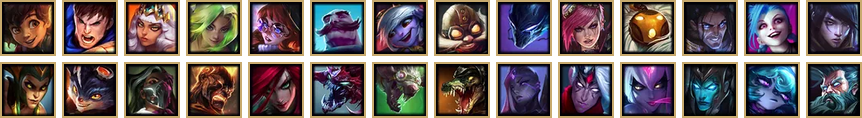
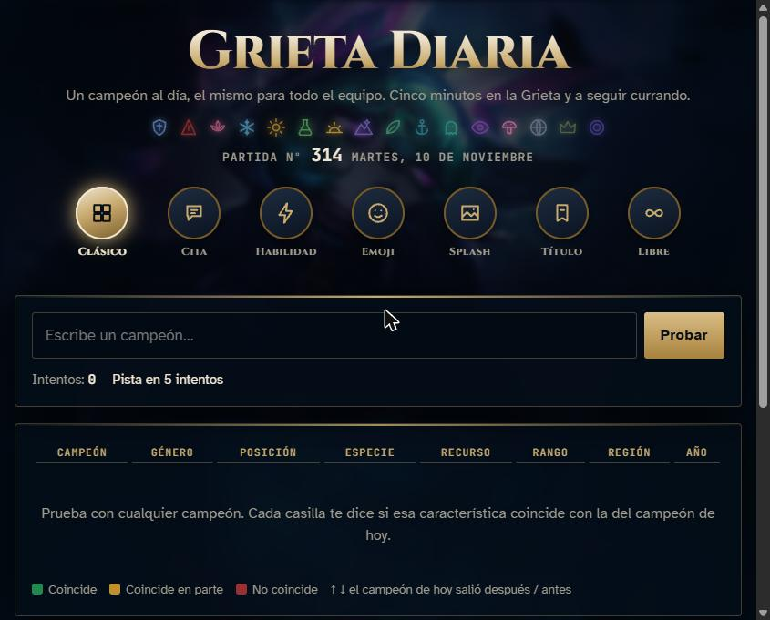

<div align="center">

# Grieta Diaria

### Un campeón de League of Legends al día. El mismo para todo el equipo.

*Cinco minutos en la Grieta y a seguir currando.*

<a href="https://paulopnun.github.io/grieta-diaria/"></a>

<br><br>




</div>

---

## Tecnologías

<div align="center">


<br>


</div>

- **El juego:** HTML, CSS y JavaScript a pelo. Ni frameworks, ni librerías, ni compilación: una sola página.
- **Los recursos:** Python con Pillow, para bajar de CommunityDragon los iconos, las habilidades, los splash y las voces, y convertirlos a WebP y MP3.
- **El alojamiento:** GitHub Pages.

---

## Modos de juego

| Modo | Cómo se juega |
|---|---|
| **Clásico** | Escribe un campeón y compara 7 características: género, posición, especie, recurso, rango, región y año. Verde si coincide, amarillo si coincide en parte, rojo si no, y una flecha que indica si el campeón de hoy salió antes o después. |
| **Cita** | Escucha lo que dice el campeón al ser elegido o al ser bloqueado. A los 4 fallos se desbloquea la otra frase. |
| **Habilidad** | Un icono de habilidad, en gris y girado. A los 3 fallos recupera el color y a los 6 se endereza. **Extra:** ¿en qué tecla va? |
| **Emoji** | Cuatro emojis que describen al campeón. Cada fallo destapa uno. |
| **Splash** | Un trozo muy ampliado de un splash art. Cada fallo aleja la imagen. **Extra:** ¿qué aspecto es? |
| **Título** | El apodo oficial del campeón, como «la Espada de los Darkin». |
| **Libre** | Partidas ilimitadas tipo Clásico con un campeón al azar. |

Cada día a las **00:00 (hora de Madrid)** salen campeones nuevos en todos los modos. La elección sale de una semilla con la fecha, así que todo el mundo juega con los mismos.

<div align="center">

</div>

---

## Lo que trae

- **Estadísticas por modo:** partidas, racha actual, mejor racha y media de intentos.
- **Cuenta atrás** hasta el campeón de mañana.
- **Copiar el resultado** con sus cuadraditos de colores, para pegarlo en el chat del equipo.
- **Fondo** con un splash difuminado distinto cada día, que nunca es la respuesta de ningún modo.
- **Sin cuentas:** los intentos y las estadísticas se guardan en el navegador de cada uno.

---

## Estructura

```
index.html          el juego entero (iconos de campeones y habilidades incrustados)
splash/<id>.webp    hasta 5 aspectos por campeón, apilados en una tira de 1280×720 cada uno
voz/<id>.json       frases de voz en MP3 (base64): "e" al elegir, "b" al bloquear
```

Para probarlo en local hace falta un servidor, porque las voces se cargan con `fetch`:

```bash
python -m http.server
# y abre http://localhost:8000
```

---

## Créditos

Imágenes, voces y datos de campeones: **Riot Games**, vía [CommunityDragon](https://www.communitydragon.org/).

<sub>*Grieta Diaria isn't endorsed by Riot Games and doesn't reflect the views or opinions of Riot Games or anyone officially involved in producing or managing Riot Games properties. Riot Games, and all associated properties are trademarks or registered trademarks of Riot Games, Inc.*</sub>

<div align="center">

**Hecho por diversión, sin ánimo de lucro.**

</div>
